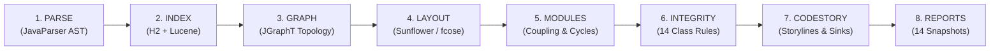
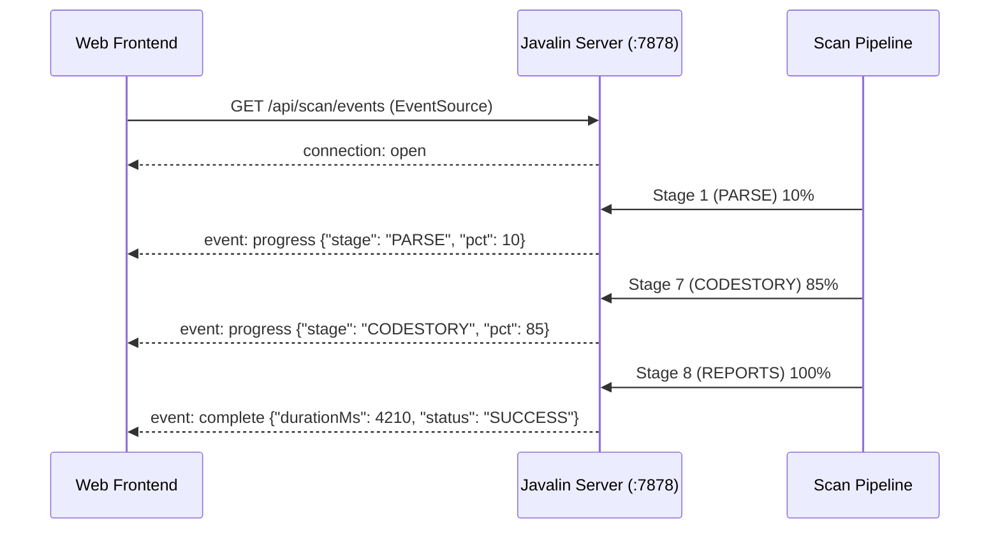

# 8-Stage Scan Pipeline & Readiness

CodeLens implements a deterministic **8-Stage Scan Pipeline** that guarantees all graphical workspaces, semantic storylines, integrity audits, and analytical reports are 100% computed and verified before the scan is marked complete.

---

## 🔄 1. The 8 Sequential Pipeline Stages

| Stage | Name | Key Operations | Artifacts Produced |
|---|---|---|---|
| **Stage 1** | `PARSE` | Parallel directory walk, AST compilation unit extraction, syntax error tolerance | Raw entity records (`classes`, `methods`, `fields`, `annotations`) |
| **Stage 2** | `INDEX` | Bulk chunk ingestion into embedded H2, inverted token creation in Lucene | Searchable Lucene index and relational tables |
| **Stage 3** | `GRAPH` | In-memory directed call graph construction, caller/callee BFS hierarchies | JGraphT directed call graph, multi-hop field impact index |
| **Stage 4** | `LAYOUT` | Sunflower spiral deterministic positioning, LOD clustering | Precomputed 2D canvas and 3D WebGL coordinates |
| **Stage 5** | `MODULES` | Intermodular class usage matrix, Martin package instability metrics ($A, I, D$) | Module coupling report, cyclic dependency detectors |
| **Stage 6** | `INTEGRITY` | 14 class-awareness rules, AST signature drift, duplicate body hash evaluation | Structural integrity violations catalog |
| **Stage 7** | `CODESTORY` | Tracing controllers to database mutation sinks, guided onboarding tour stops | Discovered transaction storylines, "Teach Me" tour |
| **Stage 8** | `REPORTS` | Precomputes all 14 analytical snapshots for instant offline retrieval | 57 pre-rendered analytical and visual report artifacts |

---

## ⚡ 2. Incremental Delta Scans

CodeLens supports lightning-fast delta scans using file-level SHA-256 change manifests:
* **Unchanged Files Skipped**: Only modified or newly introduced `.java` files are parsed through JavaParser.
* **Cascading Downstream Invalidation**: When an edited file changes method signatures, downstream topology and storyline caches are automatically invalidated and recomputed via `BackgroundTaskOrchestrator.invalidateDownstreamOnRescan()`.
* **Zero Full-Wipe Overhead**: Preserves existing H2 records for untouched modules, dropping incremental scan times down to seconds.

---

## 📡 3. Live Telemetry & Server-Sent Events (SSE)

The scanning pipeline broadcasts live real-time progress events to connected clients via `GET /api/scan/events`:

The frontend scan status modal dynamically displays the active stage pill, pulse indicators, step elapsed times, and provides instant one-click navigation to explore the generated call graph or CodeStory storylines upon completion.
