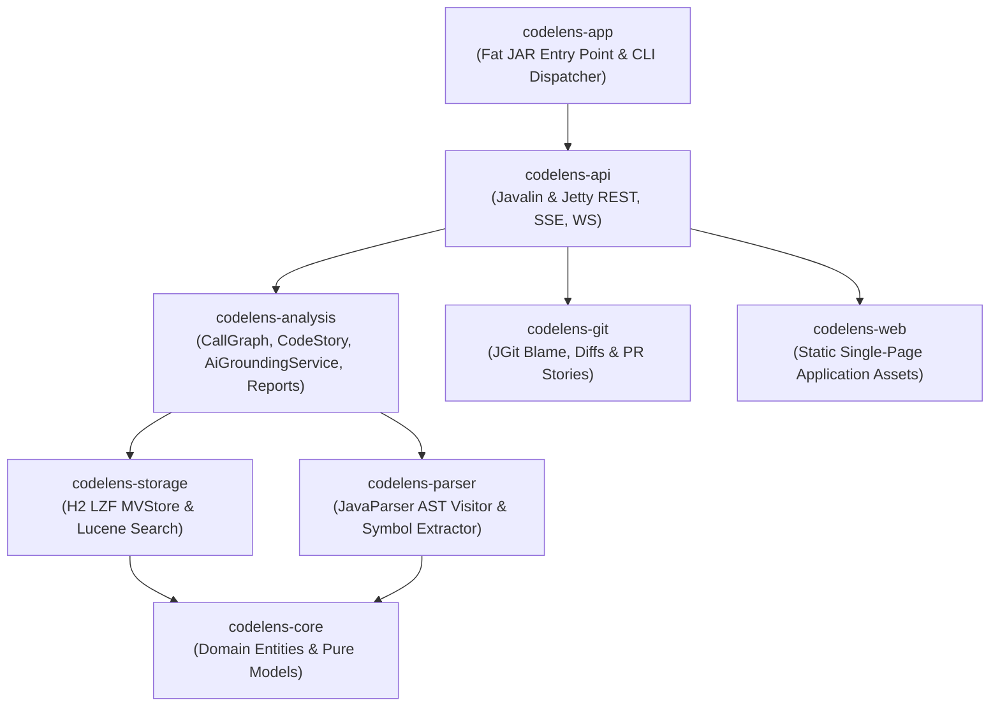
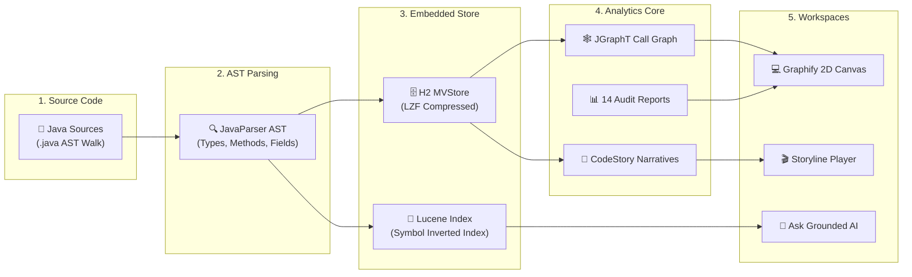
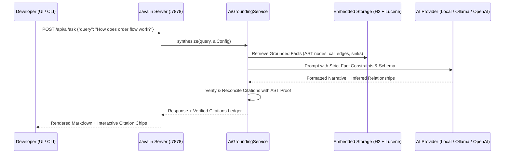

# Architecture & System Design

CodeLens is designed from the ground up to be **100% offline**, zero-telemetry, and self-contained within a local JVM process. It requires zero cloud services, external databases, or root privileges.

---

## 🏛️ 1. Multi-Module Maven Hierarchy

The system is decoupled into isolated functional layers across 8 Maven modules:

| Module | Purpose & Technologies | Key Components |
|---|---|---|
| `codelens-core` | Pure domain models, zero external dependencies | `CodeType`, `CodeRelationship`, `ScanProgress`, `CodeLensConfig` |
| `codelens-parser` | AST compilation unit analysis using JavaParser 3.25.8 | `AstVisitor`, `JavaSourceScanner`, `SemanticGraphExtractor` |
| `codelens-storage` | Embedded persistent storage with zero administration | `DatabaseManager`, `CodeLensDao`, `EntityDao`, `LuceneService` |
| `codelens-analysis` | Graph topology, CodeStory flows, AI grounding, and audit metrics | `CallGraphAnalyzer`, `StoryEngine`, `AiGroundingService`, `ChangeStoryEngine` |
| `codelens-git` | Version control annotation and churn correlation using JGit | `GitBlameService`, `GitDiffService` |
| `codelens-api` | Asynchronous REST, Server-Sent Events, and WebSockets via Javalin | `CodeLensServer`, `BackgroundTaskOrchestrator`, `HeapAutoRecoveryManager` |
| `codelens-web` | Modern vanilla JS frontend with Canvas, WebGL, and multi-theme styling | Single-page UI, Graphify 2D Canvas, 3D City/Galaxy, Ask CodeStory modal |
| `codelens-app` | Shaded fat JAR packaging and terminal CLI command entry points | `Application` (CLI and daemon launcher) |

---

## 🔄 2. Repository Ingestion & Data Flow

---

## 💾 3. Embedded Storage Subsystem

### Embedded H2 Relational Database
* **MVStore with LZF Compression**: Pages are compressed on disk using LZF, minimizing memory usage while delivering sub-millisecond retrieval.
* **Streaming JDBC Cursors**: Ingestion and call-relationship building stream entity FQNs directly through streaming cursors, avoiding large in-memory collections and preventing JVM heap spikes on 125,000+ class repositories.
* **Two-Way DB Mutex**: Heavy operations (e.g. initial scans, database compaction) acquire exclusive DB access via `BackgroundTaskOrchestrator`, preventing lock contention and file corruption.

### Apache Lucene Symbol Search
* **Inverted Token Index**: Every class, method, field, annotation, and package is indexed into an embedded Apache Lucene 9.10 directory.
* **Fuzzy & Wildcard Queries**: Instant sub-5ms typehead symbol search, regex query evaluation, and signature lookups across massive repositories.

---

## 🤖 4. AI Grounding & Semantic Fact Engine (`AiGroundingService`)

CodeLens bridges deep static analysis with AI-powered architectural reasoning while strictly adhering to air-gapped security and truthfulness constraints:

### Multi-Provider Architecture
1. **Deterministic Local Synthesizer (100% Offline)**: Generates structured, verified architectural summaries directly from AST facts, call graph hierarchies, and database sink mappings without requiring any LLM.
2. **Local Ollama Integration**: Connects to locally running LLM engines (e.g. `qwen3-coder:latest`, `llama3`, `gemma4:latest`) at `http://localhost:11434` for private, on-premise AI synthesis.
3. **OpenAI Cloud Integration**: Connects to OpenAI or internal corporate API gateways using configurable models (`gpt-4o-mini`, `gpt-4o`, custom).

### Live Handshake Verification (`POST /api/ai/test`)
Before marking an external provider verified:
* **Ollama**: Performs a live TCP handshake and checks whether Ollama is actively listening on port 11434 and has models available.
* **OpenAI**: Executes a live authenticated API handshake using the provided API key against `GET /v1/models`.
* **Local**: Verifies that the internal static analysis fact engine is initialized.

### Dynamic Model Discovery (`GET /api/ai/models`)
Queries installed models dynamically (e.g. probing Ollama's `/api/tags` endpoint) and automatically populates the model selection dropdown in both Settings and the Ask CodeStory interface.

### Verified Evidence & Citations Ledger
Every answer synthesized by the AI grounding engine includes a **Verified Source Evidence & Citations Ledger**. Readers can click any citation chip to navigate directly to the verified class, method signature, or database mutation sink in the CodeLens explorer.
