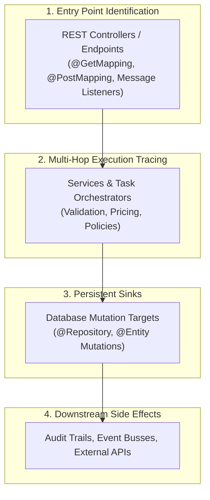
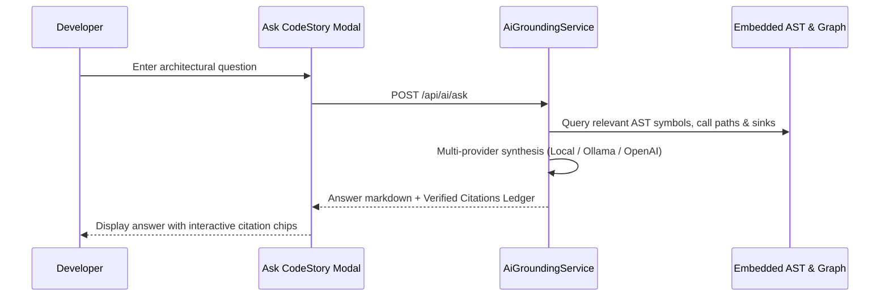

# CodeStory & Guided Tours

Rather than treating a codebase as an undifferentiated graph of thousands of classes, **CodeStory** transforms complex Java architectures into coherent, readable **transaction storylines**, progressive onboarding tours, and grounded AI architectural intelligence.


---

## 📖 1. Automated Transaction Storylines

### Workflow Extraction Engine
CodeLens systematically detects entry points (Spring `@RestController`, BaNCS business transactions, batch job runners) and traces their multi-hop execution paths across domain services until reaching a persistent database sink (`save`, `update`, `delete`, or domain mutation methods).



### Narrative Synthesis & Line-Level Citations
Each storyline is synthesized into a plain-English narrative explanation describing:
* **Business Intent**: The real-world business transaction taking place (e.g. Account Opening, Order Placement, Loan Disbursement).
* **Participant Roles**: Archetype classifications (Controller, Domain Service, Task Step, Persistence Sink).
* **Line-Level Citations**: Direct links to precise lines in the Monaco code editor.
* **Blast Radius**: Downstream side effects, database tables touched, and event listeners triggered.

### Interactive Storyline Player & Stepper Dock
* **Chronological Step Cards**: Each hop appears as a step card with sequence numbers, method names, cyclomatic complexity scores, and archetype badges.
* **Synchronized Canvas Focus**: Stepping through the flow (`‹` Prev / `›` Next) smoothly centers and pulses the graph canvas on each participating node.
* **Bidirectional Interaction**: Clicking any node in the graph highlights and scrolls to its step card in the player dock.

---

## 🎓 2. "Teach Me This Codebase" — 5-Layer Guided Onboarding Tour

The **Teach Me** tour guides new developers through unfamiliar codebases across 5 structured architectural layers:

| Layer | Focus Area | What You Learn |
|---|---|---|
| **Layer 1** | **Domain Core & Entities** | Core persistent entities, aggregates, and foundational business concepts. |
| **Layer 2** | **Ingestion & Storage** | Database access objects, repository interfaces, and data persistence contracts. |
| **Layer 3** | **Topology & Call Graphs** | High-traffic service orchestrators, task executors, and cross-module communications. |
| **Layer 4** | **Semantic Storylines** | End-to-end user journeys from external API boundaries to database commits. |
| **Layer 5** | **Intelligence & Risk Hotspots** | Behavioral hotspots, circular dependency hubs, and prioritized technical debt areas. |

Accessible via the web interface or terminal CLI (`java -jar codelens-app.jar teach-me`).

---

## 💥 3. What-If Impact Analysis & Blast Radius Simulator

Before modifying a class or method, the **What-If Impact Simulator** calculates the upstream blast radius:
* **Direct Callers**: Immediate functions directly dependent on the target symbol.
* **Transitive Ingress Callers**: All external REST controllers and scheduled jobs that transitively execute the method.
* **Breaking Change Warnings**: Flags callers where parameter changes or exceptions would cause compilation errors or unhandled runtime faults.
* Accessible in the UI via the What-If dock or via CLI: `codelens what-if OrderService.placeOrder`.

---

## 🤖 4. Ask CodeStory: Grounded Architectural Q&A

**Ask CodeStory** provides an architectural Q&A assistant accessible via keyboard shortcut (`?` or `Shift + ?`), header button, or terminal CLI:



### Multi-Provider Architecture
* **Offline Deterministic Synthesizer**: 100% offline, zero-network fallback synthesizing facts purely from static AST compilation units and call graph paths.
* **Local Ollama Integration**: Seamless integration with local models (e.g. `qwen3-coder:latest`, `llama3`, `gemma4:latest`) at `http://localhost:11434`.
* **OpenAI Cloud Integration**: Connects to OpenAI or private enterprise gateways with models such as `gpt-4o-mini`.

### Live Handshake Verification
* Selecting Ollama executes a live TCP handshake checking if port 11434 is listening.
* Selecting OpenAI validates the API key against the remote endpoint.
* Only active, reachable providers receive verified status indicators (`#10b981` emerald dot).

### Dynamic Installed Model Discovery
* Probes Ollama `/api/tags` and OpenAI `/v1/models` to discover installed models automatically.
* Automatically populates model selection dropdowns in Settings and the Ask CodeStory header.

### Verified Source Evidence & Citations Ledger
Every answer is accompanied by a citations ledger listing the exact classes, methods, and database tables verified by the engine.

---

## 🔀 5. Git PR Change Story Generator

The **Git PR Change Story Engine** automates code review analysis by generating architectural change narratives between git branches:

```bash
# Generate markdown PR story between main and feature branch
scripts/codestory-pr.sh main feature/my-branch

# Or via headless CLI
java -jar codelens-app.jar pr-story main feature/my-branch
```

* **Architectural Narrative**: Summarizes business logic changes rather than raw syntax diffs.
* **Impacted Endpoints & Sinks**: Highlights newly exposed API endpoints, modified database tables, and widened blast radiuses.
* **CI Integration**: Packaged with a GitHub Actions workflow (`.github/workflows/codestory-pr.yml`) that automatically posts architectural change stories to pull requests.
