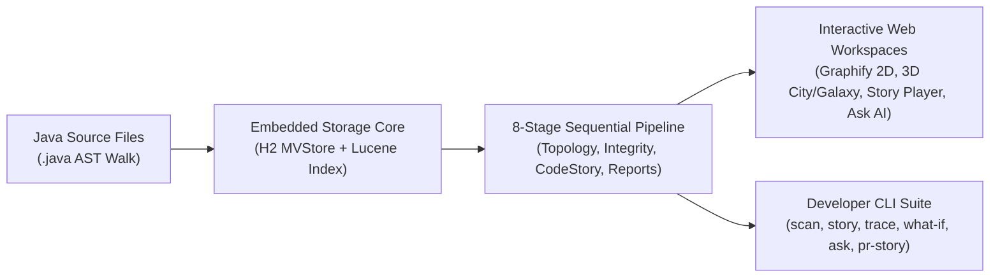

# Welcome to the CodeLens Documentation Wiki

**CodeLens** is a high-performance, **100% offline**, air-gapped Java codebase intelligence and architectural exploration platform. It transforms complex, monolithic, or unfamiliar Java repositories into intuitive, navigable architectural systems, human-readable **transaction storylines**, and grounded AI-assisted architectural intelligence.




---

## 📚 Wiki Navigation & Documentation Index

| Section | Key Topics Covered |
|---|---|
| **[1. Architecture & System Design](Architecture-and-System-Design)** | Modular multi-JAR runtime, embedded H2 LZF MVStore, Lucene indexing, in-memory JGraphT topology, and multi-provider AI Grounding Engine. |
| **[2. 8-Stage Scan Pipeline & Readiness](8-Stage-Scan-Pipeline-and-Readiness)** | Sequential 8-stage readiness pipeline (`PARSE`, `INDEX`, `GRAPH`, `LAYOUT`, `MODULES`, `INTEGRITY`, `CODESTORY`, `REPORTS`), delta scans, and modal progress tracking. |
| **[3. CodeStory & Guided Tours](CodeStory-and-Guided-Tours)** | Transaction storylines, automated sink-to-entry-point tracing, 5-layer "Teach Me" onboarding tour, **Ask CodeStory grounded AI Q&A**, and Git PR change stories. |
| **[4. Structural Integrity & Audits](Structural-Integrity-and-Audits)** | 14 class-awareness integrity rules, AST signature drift detection, duplicate body hash normalization, and 32-rule static review auditor. |
| **[5. Interactive Visualizations & 3D Studio](Interactive-Visualizations-and-3D-Studio)** | 2D Graphify Canvas, WebGL 3D Software City, 3D Galaxy, Hierarchical Treemap, Radial Sunburst, Dependency Structure Matrix (DSM), and Chord diagram. |
| **[6. Macro Architecture Studio](Macro-Architecture-Studio)** | Package and module coupling analysis, Robert C. Martin metrics ($I = C_e / (C_a + C_e)$, $A$, $D$), and inter-module dependency insights. |
| **[7. Process Hub & JVM Sentinel](Process-Hub-and-JVM-Sentinel)** | 13 registered background task engines, 5 functional pipeline stages, 2-way DB mutex, memory circuit breakers, and self-healing heap recovery. |
| **[8. Developer CLI & Toolsuite](Developer-CLI-and-Toolsuite)** | Headless terminal CLI manual: `scan`, `story`, `trace`, `what-if`, `ask`, `explain`, `teach-me`, `pr-story`, and `ai-test`. |
| **[9. REST & WebSocket API Reference](REST-and-WebSocket-API-Reference)** | Complete API documentation for REST, Server-Sent Events (SSE), and WebSocket endpoints across all subsystems. |

---

## 🚀 Quick Start

### Build & Run
```bash
# Clone the repository
git clone https://github.com/manvenpratap/codelens.git
cd codelens

# Build the fat JAR
./mvnw clean package -DskipTests

# Launch CodeLens Web Server (binds http://localhost:7878)
java -jar codelens-app/target/codelens-app.jar

# Or execute a headless scan directly from terminal
java -jar codelens-app/target/codelens-app.jar scan /path/to/java/project
```
