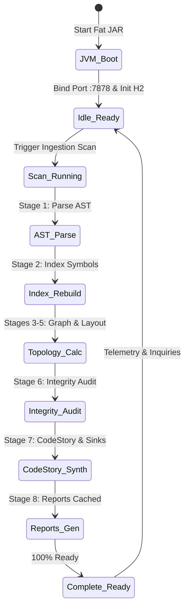
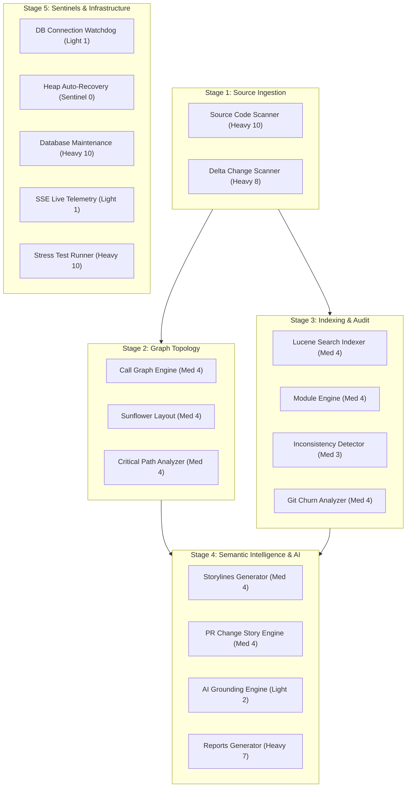

# Process Hub & JVM Sentinel

The **Process Hub & JVM Sentinel** is CodeLens's operational command center and runtime self-protection system. It provides live visibility into all background processing engines, thread allocations, memory pressure, and circuit breaker states, ensuring resilience even when analyzing massive multi-million-LOC codebases.



---

## ⚙️ 1. The 5 Functional Stages & 18 Registered Tasks

`BackgroundTaskOrchestrator` schedules background work across **5 sequential stages**, governing concurrency via **Load Tiers** (`HEAVY`, `MEDIUM`, `LIGHT`, `SENTINEL`), **Mutex Groups** (`DATABASE_EXCLUSIVE`, `ANALYSIS_EXCLUSIVE`), and **DAG Dependency Graphs**:



### Detailed Task Catalog

| Stage | Task ID | Name | Tier & Load | Mutex Group | Dependencies |
|---|---|---|---|---|---|
| **Stage 1** | `scanner` | Source Code Scanner | `HEAVY (10)` | `DATABASE_EXCLUSIVE` | None |
| **Stage 1** | `delta-scanner` | Delta Change Scanner | `HEAVY (8)` | `DATABASE_EXCLUSIVE` | None |
| **Stage 2** | `call-graph` | Call Graph & Topology Engine | `MEDIUM (4)` | `NONE` | `scanner` |
| **Stage 2** | `layout-engine` | Sunflower Layout Precomputer | `MEDIUM (4)` | `NONE` | `call-graph` |
| **Stage 2** | `critical-path-analyzer` | Critical Execution Path Analyzer | `MEDIUM (4)` | `NONE` | `call-graph` |
| **Stage 3** | `lucene-indexer` | Lucene Full-Text Search Indexer | `MEDIUM (4)` | `NONE` | `scanner` |
| **Stage 3** | `module-analyzer` | Module Dependency Engine | `MEDIUM (4)` | `NONE` | `scanner` |
| **Stage 3** | `inconsistency-detector` | Structural Inconsistency Detector | `MEDIUM (3)` | `NONE` | `scanner` |
| **Stage 3** | `git-analyzer` | Git Churn & Hotspot Analyzer | `MEDIUM (4)` | `NONE` | `scanner` |
| **Stage 4** | `storylines-generator` | CodeStory Narrative Flows | `MEDIUM (4)` | `NONE` | `call-graph`, `scanner` |
| **Stage 4** | `change-story-analyzer` | Git PR Change Story Engine | `MEDIUM (4)` | `NONE` | `storylines-generator`, `git-analyzer` |
| **Stage 4** | `ai-grounding-engine` | Architectural Q&A & Semantic AI | `LIGHT (2)` | `NONE` | `storylines-generator`, `call-graph` |
| **Stage 4** | `reports-generator` | Intelligence Reports Generator | `HEAVY (7)` | `ANALYSIS_EXCLUSIVE` | `call-graph`, `module-analyzer`, `lucene-indexer` |
| **Stage 5** | `db-watchdog` | Database Connection Watchdog | `LIGHT (1)` | `NONE` | None |
| **Stage 5** | `heap-watchdog` | Heap Auto-Recovery Watchdog | `SENTINEL (0)` | `NONE` | None |
| **Stage 5** | `db-maintenance` | Database Compaction & Vacuum | `HEAVY (10)` | `DATABASE_EXCLUSIVE` | None |
| **Stage 5** | `sse-broadcaster` | SSE Live Telemetry Broadcaster | `LIGHT (1)` | `NONE` | None |
| **Stage 5** | `stress-test` | Scale & Stress Test Runner | `HEAVY (10)` | `DATABASE_EXCLUSIVE` | None |

---

## 🛡️ 2. JVM Sentinel & Heap Auto-Recovery

To prevent `OutOfMemoryError` (OOM) during heavy codebase scans, the **JVM Sentinel** actively tracks memory pressure:

```
0% ──────────── 75% ─────────────── 85% ───────────── 100%
     HEALTHY          WARNING            TRIPPED
   [  Normal  ]   [ Evict Caches ]   [ Throttle Ingestion ]
                  [ Proactive GC ]   [ Circuit Breaker OPEN ]
```

* **Warning Threshold (75% Heap)**: Automatically evicts in-memory report JSON caches, trims H2 buffer pools, and requests cooperative garbage collection.
* **Critical Threshold (85% Heap)**: Trips the circuit breaker, pauses non-essential background tasks, throttles active workers, and rolls back uncommitted batch chunks.
* **Resume Threshold (80% Heap)**: Resumes throttled tasks once memory pressure drops below safe operational boundaries.

---

## 🧵 3. Live Diagnostic Thread Dumps

The Process Hub provides instant, non-blocking JVM thread stack inspection via `GET /api/system/threads/dump`:
* Captures thread states (`RUNNABLE`, `WAITING`, `TIMED_WAITING`, `BLOCKED`).
* Highlights lock contention, monitor synchronizers, and thread deadlocks.
* Offers one-click text copy and file download in the Process Hub modal.
